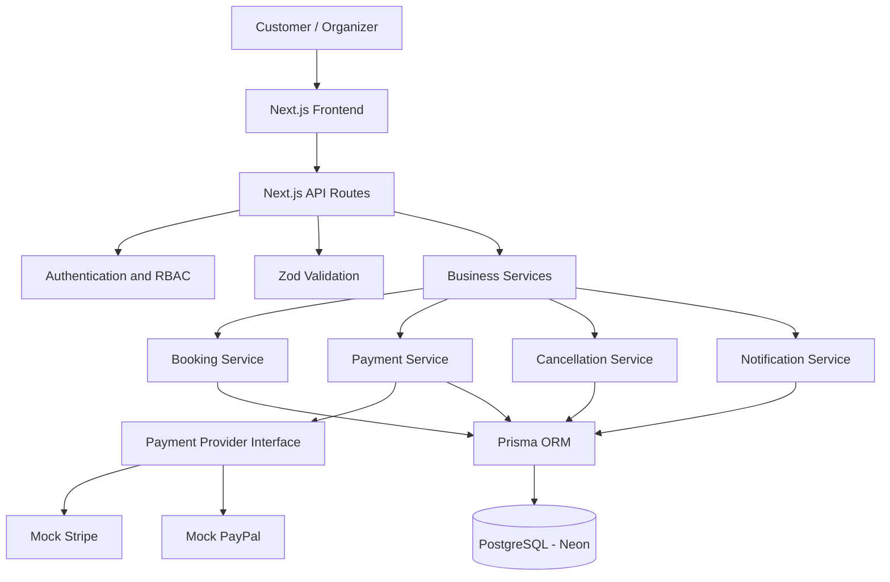

# TicketFlow Architecture

## 1. Overview

TicketFlow uses a layered architecture within a single Next.js application.

The frontend pages, backend API routes, business logic, authentication, and database access are organized into separate responsibilities.

## 2. Architecture Diagram



## 3. Main Layers

### Presentation Layer

Location: `src/app/`

Contains Next.js pages, forms, dashboards, and API route handlers.

### Authentication and Validation Layer

- Clerk handles user authentication.
- Database roles support role-based access control.
- Zod validates incoming API data.

### Business Logic Layer

Location: `src/lib/`

Contains booking, payment, cancellation, pricing, and notification-related business logic.

### Data Access Layer

- Prisma ORM manages database operations.
- PostgreSQL stores users, events, venues, seats, bookings, payments, and notifications.

## 4. Important Design Patterns

### Strategy Pattern

Different pricing strategies allow the system to calculate ticket prices using different rules, such as base pricing and early-bird pricing.

**Why:** Pricing rules can be extended without mixing them with booking logic.

### Factory Pattern

The payment provider factory selects the appropriate payment provider, such as Mock Stripe or Mock PayPal.

**Why:** Provider creation is separated from payment processing.

### Provider Abstraction

A common payment provider interface defines the operations required by payment providers.

**Why:** New providers can be introduced without rewriting the core payment service.

### Service Layer Pattern

Booking, payment, cancellation, and notification responsibilities are separated into services.

**Why:** This keeps API handlers focused on HTTP requests and responses.

## 5. SOLID Principles

- **Single Responsibility Principle (SRP):** Booking, payment, cancellation, and notification logic have separate responsibilities.
- **Open/Closed Principle (OCP):** The payment provider abstraction allows additional providers to be introduced with minimal changes to existing payment logic.
- **Dependency Inversion Principle (DIP):** Payment processing depends on a provider abstraction rather than directly depending on a specific payment implementation.

## 6. Double Booking Prevention

TicketFlow uses database-level concurrency controls.

1. A customer requests a seat hold.
2. The application validates seat availability.
3. Conditional database updates claim only seats that are still available.
4. Database transactions ensure partial seat claims are rolled back if the complete request cannot succeed.
5. Payment processing uses booking row locking with `SELECT FOR UPDATE`.
6. Idempotency keys prevent duplicate payment processing for repeated requests.

This approach helps prevent two customers from successfully booking the same seat.

## 7. Booking Lifecycle

```text
HELD
  |
  v
PENDING_PAYMENT
  |
  v
CONFIRMED
  |
  v
CANCELLED
```

Additional outcomes include:

- EXPIRED: Temporary hold expires.
- CANCELLED: Customer cancels a confirmed booking.
- REFUND_PENDING: Refund processing is in progress.
- REFUNDED: Refund succeeds.

## 8. Notification Architecture

The notification service uses separate notification channels:

- In-app notifications are persisted in PostgreSQL.
- Console-based email notification implementation logs email messages.

## 9. Future Improvements

- Automated background jobs for expired seat holds.
- Real payment gateway integration.
- Automated unit and integration testing.
- More robust refund reconciliation.
- Dedicated email delivery provider.
- Automated CI quality checks.
